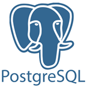

# TrelloMicroservices

"Microservicios en un monorepositorio para una aplicación de Trello" - ArmandoEnrique1010k

---
# Índice
- [Introducción](#Introducción)
	- [Descripción del proyecto](#descripción-del-proyecto)
	- [Objetivos](#objetivos)
	- [Tecnologías utilizadas](#tecnologías-utilizadas)
	- [Características principales](#características-principales)
- [Arquitectura del proyecto](#arquitectura-del-proyecto)
	- [Arquitectura de microservicios](#arquitectura-de-microservicios)
	- [Patrón de monorepositorio](#patrón-de-monorepositorio)
	- [Herencia y gestión centralizada de dependencias](#herencia-y-gestión-centralizada-de-dependencias)
	- [Diagrama de solución funcional en un entorno local](#diagrama-de-solución-funcional-en-un-entorno-local)
	- [Estructura de directorios y módulos](#estructura-de-directorios-y-módulos)
- Diseño funcional y modelo de datos
	- Casos de uso
	- Diagrama UML de entidades
		- Identity
		- Project
		- Workflow
- Configuración y ejecución del proyecto
	- Requisitos previos
	- Variables de entorno
	- Generación de claves RSA para JWT
	- Configuración de infraestructura con Docker
	- Limpieza de datos y generación de datos de prueba
	- Comprobación de contraseña BCrypt
- Decisiones de arquitectura e implementación
- Autenticación y autorización con Spring Security y OAuth2
- Implementación de Resend para el envio de correos
- MapStruct y mapeo de objetos
- Documentación de API con Swagger UI
- Comunicación entre microservicios con OpenFeign
- Resiliencia y tolerancia a fallos entre microservicios
- Patrón SAGA y consistencia de datos entre microservicios
- Transacciones compensatorias
- Procesamiento de operaciones pendientes
- Escenarios de funcionamiento y tolerancia a fallos del patrón SAGA
- Bibliografía

---
# Introducción

El presente proyecto tiene como finalidad demostrar los conocimientos adquiridos en el desarrollo de una APIs REST utilizando una arquitectura de microservicios con Spring Boot y Spring Cloud. Su construcción también permitió profundizar en la toma de decisiones de arquitectura de software, la comunicación entre servicios independientes y el manejo de operaciones distribuidas.

El desarrollo tomó como referencia dos cursos: [Microservicios y APIs REST con Spring Boot, OAuth2 y Docker](https://www.udemy.com/course/microservicios-spring-boot-cloud-docker-profesional/), de Carlos Adrián Soto Botero, y [React y TypeScript - La Guía Completa Creando +10 Proyectos](https://www.udemy.com/course/react-de-principiante-a-experto-creando-mas-de-10-aplicaciones/), de Juan Pablo de la Torre. En particular, se tomó como referencia la lógica de negocio de la aplicación **UpTask** desarrollada en este último curso, adaptándola y extendiéndola para trasladar su backend de una arquitectura monolítica basada en Node.js a una arquitectura de microservicios implementada con Spring Boot, incorporando nuevas funcionalidades y decisiones de diseño.

**Tiempo aproximado de desarrollo:** 3 meses.

## Descripción del proyecto

Se trata de una API REST que implementa la lógica de negocio de una aplicación de gestión de proyectos y tareas similar a Trello. Permite a los usuarios administrar espacios de trabajo, crear tableros y gestionar colaborativamente sus tareas, etiquetas y notas.

El funcionamiento de la aplicación comienza con el registro de un usuario, quien debe activar su cuenta mediante un código de verificación de seis dígitos enviado a su dirección de correo electrónico. Una vez activada la cuenta, puede iniciar sesión y comenzar a administrar sus espacios de trabajo.

Dentro de cada espacio de trabajo, el usuario puede crear tableros e invitar a otros usuarios registrados mediante su dirección de correo electrónico. Al enviar una invitación, debe asignar un rol que determinará los permisos y las operaciones que podrá realizar el usuario invitado dentro del tablero: ADMIN, MEMBER o VIEWER.

El destinatario de la invitación puede aceptarla o rechazarla. Si la acepta, adquiere acceso al tablero con los permisos correspondientes a su rol. Entre las funcionalidades disponibles se encuentran la creación y administración de tareas, la modificación de sus estados, la consulta de sus detalles, la gestión de notas y la visualización del historial de cambios realizados.

El backend está dividido en tres microservicios independientes:

- **Identity:** responsable de la gestión de usuarios, autenticación, autorización y administración de las credenciales.
- **Project:** encargado de la gestión de espacios de trabajo, tableros, invitaciones y miembros.
- **Workflow:** responsable de la gestión de los tableros a nivel operativo, incluyendo tareas, etiquetas, notas e historiales.

Cada microservicio dispone de su propia base de datos PostgreSQL, manteniendo la separación de responsabilidades y la autonomía de persistencia.

## Objetivos

Los principales objetivos del proyecto son:

- Aplicar conocimientos de arquitectura de software mediante la implementación de una arquitectura de microservicios.
- Demostrar la comunicación entre tres microservicios independientes mediante OpenFeign.
- Implementar mecanismos de autenticación y autorización utilizando Spring Security, OAuth2 y JWT.
- Aplicar patrones y herramientas para la gestión de errores, resiliencia y tolerancia a fallos en las comunicaciones entre microservicios.
- Implementar el patrón SAGA síncrono para gestionar operaciones distribuidas y mantener la consistencia de los datos entre diferentes bases de datos.
- Analizar el comportamiento y las limitaciones del patrón SAGA síncrono ante diferentes escenarios de fallos.
- Realizar pruebas funcionales de los endpoints mediante Swagger UI.
- Comprobar la persistencia y modificación de los datos en PostgreSQL a través de las operaciones ejecutadas desde Swagger UI.
- Utilizar Spring Boot Actuator para supervisar los servicios, consultar los estados de los Circuit Breakers y analizar sus eventos.
- Proporcionar una configuración de infraestructura y variables de entorno que permita reproducir el entorno de desarrollo local mediante Docker.

## Tecnologías utilizadas

Las principales tecnologías, frameworks y librerías utilizadas para el desarrollo de los microservicios son:

### Núcleo y arquitectura base

| Tecnología       | Descripción                                                                                                    |
| ---------------- | -------------------------------------------------------------------------------------------------------------- |
| Java             | Es el lenguaje de programación principal del backend.                                                          |
| Spring Framework | El framework base que proporciona el contenedor de dependencias y los mecanismos de inyección de dependencias. |
| Spring Boot      | Simplifica la configuración, desarrollo y ejecución independiente de cada microservicio.                       |
| Spring Cloud     | Es el ecosistema de herramientas para implementar funcionalidades relacionadas con arquitecturas distribuidas. |


### Persistencia y datos

| Tecnología      | Descripción                                                                                                          |
| --------------- | -------------------------------------------------------------------------------------------------------------------- |
| Spring Data JPA | Proporciona abstracción para la persistencia y acceso a bases de datos mediante repositorios y consultas JPA.        |
| PostgreSQL      | Es el sistema de gestión de bases de datos relacional utilizado para almacenar la información de cada microservicio. |



### Desarrollo web y APIs

| Tecnología                     | Descripción                                                                                                          |
| ------------------------------ | -------------------------------------------------------------------------------------------------------------------- |
| Spring Web                     | Sirve en el desarrollo de endpoints REST y gestión de peticiones HTTP.                                               |
| OpenAPI / Swagger UI           | Proporciona una documentación interactiva y ejecución de pruebas de los endpoints REST.                              |
| Spring Boot Starter Validation | Gestiona la validación de datos de entrada mediante anotaciones de Bean Validation.                                  |
| Resend                         | Es un servicio externo de envío de correos electrónicos transaccionales, es utilizado para la activación de cuentas. |


### Mapeo y generación de código

| Tecnología | Descripción                                                                                                 |
| ---------- | ----------------------------------------------------------------------------------------------------------- |
| MapStruct  | Genera código para realizar conversiones entre entidades, DTOs y otros objetos Java.                        |
| Lombok     | Reduce código repetitivo mediante anotaciones para generar constructores, getters, setters y otros métodos. |


### Seguridad y autenticación

| Tecnología             | Descripción                                                                                                                                   |
| ---------------------- | --------------------------------------------------------------------------------------------------------------------------------------------- |
| Spring Security        | Es un framework de Java para la gestión de autenticación, autorización, protección de endpoints y mitigación de vulnerabilidades comunes.     |
| OAuth2 Resource Server | Protocolo estándar para la autorización delegada y manejo de tokens JWT utilizados para autenticar las solicitudes HTTP entre microservicios. |


### Comunicación entre microservicios y resiliencia

| Tecnología                   | Descripción                                                                                                                  |
| ---------------------------- | ---------------------------------------------------------------------------------------------------------------------------- |
| Spring Cloud OpenFeign       | Es el cliente  HTTP declarativo utilizado para la comunicación síncrona entre microservicios.                                |
| Apache HttpClient            | Es el cliente HTTP utilizado para configurar y ejecutar peticiones que requieren métodos como PATCH.                         |
| Resilience4j Circuit Breaker | Librería ligera para el aislamiento de fallos en las comunicaciones entre microservicios mediante el patrón Circuit Breaker. |
| Resilience4j Retry           | Es un módulo de Resilience4j para la gestión de reintentos automáticos ante determinados errores en las comunicaciones.      |


### Observabilidad e infraestructura

| Tecnología           | Descripción                                                                                                                                                                 |
| -------------------- | --------------------------------------------------------------------------------------------------------------------------------------------------------------------------- |
| Spring Boot Actuator | Es un módulo de Spring Boot que expone métricas operativas de los microservicios y consulta de información operativa, incluyendo estados y eventos de los Circuit Breakers. |
| Docker               | Es la herramienta para la creación y gestión de contenedores, además de la configuración de la infraestructura necesaria para ejecutar el entorno de desarrollo local.      |


## Características principales

- **Arquitectura de microservicios:** división del backend en tres servicios independientes: Identity, Project y Workflow.
- **Monorepositorio:** organización centralizada del código fuente, con gestión y configuración compartida de los microservicios.
- **Autenticación y autorización:** registro de usuarios, activación de cuentas mediante códigos de verificación enviados por correo electrónico, inicio de sesión y protección de endpoints mediante JWT.
- **Gestión de espacios de trabajo y tableros:** creación y administración de espacios de trabajo, tableros, invitaciones y membresías.
- **Control de acceso basado en roles:** asignación de permisos y restricciones a los miembros de un tablero según el rol que tengan asignado.
- **Gestión de tareas:** creación, modificación y consulta de tareas, incluyendo la administración de sus estados, notas e historial de cambios.
- **Comunicación entre microservicios:** integración mediante OpenFeign para realizar consultas y ejecutar operaciones entre servicios.
- **Resiliencia y tolerancia a fallos:** implementación de Circuit Breaker, Retry y Fallback Factory para gestionar errores de comunicación, indisponibilidad y latencia entre microservicios.
- **Consistencia de datos mediante SAGA síncrono:** registro y seguimiento de operaciones distribuidas, gestión de sus estados y ejecución de transacciones compensatorias ante fallos.
- **Procesamiento de operaciones pendientes:** ejecución programada de tareas en segundo plano para recuperar y procesar operaciones que no pudieron completarse.
- **Documentación y pruebas de API:** uso de Swagger UI para explorar, documentar y ejecutar los endpoints de cada microservicio.
- **Supervisión de servicios:** uso de Spring Boot Actuator para consultar información operativa, estados de los Circuit Breakers y sus respectivos eventos.
- **Infraestructura de desarrollo con Docker:** configuración de contenedores y bases de datos para reproducir el entorno de desarrollo local.

# Arquitectura del proyecto

Para el desarrollo del proyecto he aplicado diferentes conceptos y decisiones relacionados con la arquitectura de software, orientados a mantener una estructura organizada, facilitar la reutilización de componentes y establecer una separación de responsabilidades entre los microservicios.

## Arquitectura de microservicios

El proyecto implementa una arquitectura basada en microservicios, un estilo arquitectónico que permite estructurar una aplicación como un conjunto de servicios independientes, cada uno enfocado en un dominio específico del negocio. Esta decisión se tomó en lugar de desarrollar una arquitectura monolítica, con el objetivo de conseguir una mayor separación de responsabilidades, autonomía de los componentes, facilidad de mantenimiento y capacidad de evolución independiente.

La solución está compuesta por tres microservicios principales: Identity, Project y Workflow, cada uno con su propia lógica de negocio, responsabilidades y base de datos. Esta distribución permite que los servicios gestionen sus respectivos dominios sin depender directamente de la estructura interna de los demás.

La comunicación entre microservicios se realiza mediante OpenFeign, utilizando solicitudes HTTP para intercambiar información y ejecutar operaciones que requieren la colaboración de otros servicios. Para gestionar la consistencia de los datos en operaciones que involucran a múltiples microservicios, se implementa el patrón SAGA, que permite coordinar transacciones distribuidas mediante una secuencia de operaciones y acciones compensatorias en caso de fallos.

### Organización y responsabilidades

Los microservicios se dividen de acuerdo con los dominios funcionales de la aplicación:

- **Identity**: responsable de la gestión de identidades, autenticación, autorización y administración de la información de los usuarios. También gestiona los mecanismos de seguridad basados en JWT y tokens de actualización.
- **Project**: encargado de la gestión de espacios de trabajo, proyectos, membresías, invitaciones y permisos de acceso. Además, coordina determinadas operaciones de negocio que requieren la participación de otros microservicios.
- **Workflow**: responsable de la gestión de tableros, tareas, etiquetas, notas y demás elementos relacionados con la organización y seguimiento del trabajo.

Esta separación permite que cada servicio concentre sus funcionalidades en un contexto de negocio definido, evitando que toda la lógica de la aplicación se encuentre agrupada en un único componente.

### Autonomía y comunicación entre servicios

Cada microservicio mantiene su propia base de datos y es responsable de administrar exclusivamente la información correspondiente a su dominio. No existe una base de datos compartida entre los servicios, por lo que el acceso a información perteneciente a otro dominio se realiza mediante sus respectivas interfaces de comunicación.

Para facilitar esta interacción se utiliza Spring Cloud OpenFeign, que permite declarar clientes HTTP mediante interfaces Java y simplificar las solicitudes entre servicios. Asimismo, se incorporan mecanismos de tolerancia a fallos, como Circuit Breaker y Retry, para mejorar la resiliencia de las comunicaciones ante situaciones de indisponibilidad o errores temporales.

### Consistencia de datos y operaciones distribuidas

Debido a que cada microservicio administra su propia base de datos, las operaciones que involucran a varios servicios no pueden resolverse mediante una única transacción local de base de datos.

Para abordar este escenario se implementa el patrón SAGA, que permite coordinar una secuencia de transacciones locales ejecutadas en diferentes microservicios. Cuando una operación no puede completarse, se pueden ejecutar acciones compensatorias para revertir los efectos de las operaciones que ya se realizaron.

En este proyecto, la coordinación de estas operaciones se gestiona mediante el microservicio Project, que registra y controla los estados de las operaciones distribuidas. También se contemplan mecanismos de reintento, idempotencia y revisión manual para gestionar situaciones en las que una operación o su compensación no pueden completarse automáticamente.

### Ventajas y desventajas de la arquitectura

La adopción de este estilo arquitectónico proporciona beneficios importantes, pero también introduce complejidades que deben considerarse durante el desarrollo y mantenimiento de la aplicación.

|Ventajas|Desventajas|
|---|---|
|Separación de responsabilidades por dominios de negocio.|Mayor complejidad en el desarrollo y mantenimiento.|
|Independencia de las bases de datos.|Necesidad de gestionar la consistencia de datos distribuida.|
|Evolución y despliegue independiente de los servicios.|Dependencia de la comunicación mediante red.|
|Mayor facilidad para escalar servicios específicos.|Mayor complejidad en la monitorización y depuración.|
|Aislamiento de determinados fallos entre servicios.|Necesidad de implementar mecanismos de resiliencia y recuperación.|

### Consideraciones finales

La arquitectura de microservicios permite construir una aplicación modular, distribuida y organizada por dominios de negocio. Sin embargo, su implementación implica asumir responsabilidades adicionales relacionadas con la comunicación entre servicios, la disponibilidad, la consistencia de datos y la gestión de errores distribuidos.

En este proyecto, la combinación de Spring Boot, Spring Cloud OpenFeign, Resilience4j y el patrón SAGA permite abordar estas necesidades, estableciendo una arquitectura que prioriza la independencia de los servicios, la tolerancia a fallos y la coordinación de operaciones distribuidas.

La elección de esta arquitectura responde principalmente a un objetivo de aprendizaje y aplicación práctica de conceptos avanzados de desarrollo backend, además de permitir explorar los desafíos técnicos que aparecen al construir y mantener sistemas distribuidos.

## Patrón de monorepositorio

El proyecto utiliza el **patrón de monorepositorio (monorepo)** para organizar los diferentes microservicios y módulos que conforman la aplicación.

Bajo este enfoque, el código fuente de todos los componentes del sistema se mantiene dentro de un único repositorio. Esto permite centralizar su gestión, facilitar la reutilización de componentes y mantener una configuración común entre los diferentes módulos.

Para implementar esta estructura se utiliza **Maven**, aprovechando su sistema de gestión de dependencias y el mecanismo de herencia entre proyectos.

La estructura contempla dos niveles principales:

- `trelloparent`: módulo padre encargado de centralizar la configuración y gestionar las dependencias compartidas por los módulos que heredan de él.
- `businessdomain`: módulo que agrupa los diferentes microservicios del dominio de negocio y hereda la configuración definida en `trelloparent`.
- `infrastructure`: módulo que agrupa los diferentes microservicios de la infraestructura y hereda la configuración definida en `trelloparent`.

A partir de esta organización, los microservicios mantienen sus propias configuraciones y dependencias específicas, mientras que los elementos comunes pueden administrarse desde los módulos superiores, evitando duplicaciones innecesarias.

La siguiente imagen muestra la estructura de directorios del repositorio y la relación jerárquica entre sus diferentes módulos.

La siguiente imagen muestra la estructura de carpetas del repositorio y la relación entre los diferentes módulos:


## Herencia y gestión centralizada de dependencias

El proyecto utiliza el modelo de herencia de proyectos de **Maven** para centralizar configuraciones, administrar versiones de dependencias y evitar la duplicación de código en los archivos `pom.xml` de los diferentes módulos.

Para conseguirlo, se ha establecido una jerarquía de tres niveles: `trelloparent`, `businessdomain` y los microservicios individuales. Cada nivel tiene responsabilidades específicas en cuanto a la administración de dependencias y configuraciones.

### Módulo padre

El módulo `trelloparent` constituye la raíz de la estructura multimódulo del proyecto. Su archivo `pom.xml` define las propiedades generales, los módulos que forman parte del repositorio y las configuraciones que serán heredadas por los módulos hijos.

Inicialmente, se definen las propiedades principales del proyecto:

```xml
    <groupId>com.trello</groupId>
    <artifactId>trelloparent</artifactId>
    <version>1.0</version>
    <packaging>pom</packaging>

    <name>trelloparent</name>
    <description>Proyecto padre para los demás microservicios</description>
```

El atributo `packaging` con valor `pom` indica que este módulo funciona como un proyecto padre y agregador de otros módulos, en lugar de generar un archivo ejecutable.

A continuación, se declaran los módulos que forman parte de esta primera jerarquía:

```xml
    <modules>
        <module>businessdomain</module>
        <module>infrastructure</module>
    </modules>
```

De esta manera, Maven reconoce `businessdomain` e `infrastructure` como módulos pertenecientes al proyecto principal.

#### Gestión de versiones

Para evitar declarar repetidamente las versiones de las principales tecnologías, se utilizan propiedades personalizadas:

```xml
    <properties>
        <java.version>25</java.version>
        <spring-cloud.version>2025.1.2</spring-cloud.version>
        <spring-boot.version>4.1.0</spring-boot.version>
    </properties>
```

Estas propiedades permiten administrar las versiones desde un único punto y reutilizarlas en las configuraciones de los diferentes módulos.

#### Gestión de dependencias compartidas

Maven proporciona dos mecanismos importantes para declarar dependencias: `<dependencies>` y `<dependencyManagement>`.

- `<dependencies>`: incorpora las dependencias al proyecto. Cuando se declara en un POM padre, estas también son heredadas por sus módulos hijos.
- `<dependencyManagement>`: centraliza las versiones y configuraciones de las dependencias, pero no obliga a los módulos hijos a incorporarlas. Cada módulo debe declararlas individualmente si necesita utilizarlas.

En este proyecto se utiliza `<dependencyManagement>` para importar los BOM (_Bill of Materials_) de Spring Boot y Spring Cloud:

```xml
    <dependencyManagement>
        <dependencies>
            <dependency>
                <groupId>org.springframework.boot</groupId>
                <artifactId>spring-boot-dependencies</artifactId>
                <version>${spring-boot.version}</version>
                <type>pom</type>
                <scope>import</scope>
            </dependency>

            <dependency>
                <groupId>org.springframework.cloud</groupId>
                <artifactId>spring-cloud-dependencies</artifactId>
                <version>${spring-cloud.version}</version>
                <type>pom</type>
                <scope>import</scope>
            </dependency>
        </dependencies>
    </dependencyManagement>
```

Los BOM permiten administrar de manera centralizada las versiones de un conjunto de dependencias relacionadas, evitando tener que especificar manualmente sus versiones cada vez que se incorporan a un módulo.

Por otro lado, se declaran algunas dependencias dentro de `<dependencies>` porque son necesarias en todos los módulos que heredan directamente de `trelloparent`:

```xml
    <dependencies>
        <dependency>
            <groupId>org.springframework.boot</groupId>
            <artifactId>spring-boot-starter-actuator</artifactId>
        </dependency>

        <dependency>
            <groupId>org.springframework.boot</groupId>
            <artifactId>spring-boot-devtools</artifactId>
        </dependency>

        <dependency>
            <groupId>org.springframework.boot</groupId>
            <artifactId>spring-boot-starter-test</artifactId>
            <scope>test</scope>
        </dependency>
    </dependencies>
```

Finalmente, se declara el plugin `spring-boot-maven-plugin`, que permite configurar las tareas relacionadas con la construcción y empaquetado de las aplicaciones Spring Boot.

```xml
    <build>
        <plugins>
            <plugin>
                <groupId>org.springframework.boot</groupId>
                <artifactId>spring-boot-maven-plugin</artifactId>
            </plugin>
        </plugins>
    </build>
```

### Módulo intermedio

El módulo `businessdomain` hereda la configuración definida en `trelloparent` y funciona como módulo padre de los tres microservicios que conforman el dominio de negocio.

Su archivo `pom.xml` declara los siguientes módulos:

```xml
    <modules>
        <module>project</module>
        <module>identity</module>
        <module>workflow</module>
    </modules>
```

Además de agrupar los microservicios, `businessdomain` centraliza las propiedades y dependencias que son comunes a estos módulos.

#### Propiedades compartidas

Se definen las versiones de algunas librerías utilizadas durante el desarrollo:

```xml
    <properties>
        <maven.compiler.source>25</maven.compiler.source>
        <maven.compiler.target>25</maven.compiler.target>
        <org.mapstruct.version>1.6.3</org.mapstruct.version>
        <org.lombok.version>1.18.46</org.lombok.version>
        <org.springdoc.version>3.1.0</org.springdoc.version>        <org.lombok.mapstruct.binding.version>0.2.0</org.lombok.mapstruct.binding.version>
        <org.validation.version>4.1.0</org.validation.version>
        <postgres.version>42.7.2</postgres.version>
    </properties>
```

#### Dependencias heredables

En `<dependencies>` se incorporan las librerías que necesitan los tres microservicios para desarrollar sus funcionalidades:

```xml
	<dependencies>
	    <dependency>
	        <groupId>org.springframework.boot</groupId>
	        <artifactId>spring-boot-starter</artifactId>
	    </dependency>
	
	    <dependency>
	        <groupId>org.springframework.boot</groupId>
	        <artifactId>spring-boot-starter-web</artifactId>
	    </dependency>
	
	    <dependency>
	        <groupId>org.springframework.cloud</groupId>
	        <artifactId>spring-cloud-starter-loadbalancer</artifactId>
	    </dependency>
	
	    <dependency>
	        <groupId>org.mapstruct</groupId>
	        <artifactId>mapstruct</artifactId>
	        <version>${org.mapstruct.version}</version>
	    </dependency>
	
	    <dependency>
	        <groupId>org.projectlombok</groupId>
	        <artifactId>lombok</artifactId>
	        <version>${org.lombok.version}</version>
	    </dependency>
	
	    <dependency>
	        <groupId>org.springdoc</groupId>
	        <artifactId>springdoc-openapi-starter-webmvc-ui</artifactId>
	        <version>${org.springdoc.version}</version>
	    </dependency>
	</dependencies>
```

También se centraliza la configuración del compilador de Maven mediante `maven-compiler-plugin`, incluyendo los procesadores de anotaciones necesarios para MapStruct y Lombok, así como `lombok-mapstruct-binding` para garantizar su correcta integración durante la compilación.

#### Consideraciones sobre la herencia de dependencias

No todas las dependencias deben declararse dentro de `businessdomain`. Es necesario evaluar si realmente deben estar disponibles en todos los microservicios que heredan de este módulo.

Por ejemplo, no sería conveniente incorporar `spring-boot-starter-security` dentro de `<dependencies>` de `businessdomain` si solamente algunos microservicios necesitan utilizar Spring Security. Pero en este caso si será necesario porque los 3 microservicios van a heredar las dependencias de Spring Security y Oauth2.

```xml
	<dependencies>
        <dependency>
            <groupId>org.springframework.boot</groupId>
            <artifactId>spring-boot-starter-security</artifactId>
        </dependency>

        <dependency>
            <groupId>org.springframework.boot</groupId>
            <artifactId>spring-boot-starter-oauth2-resource-server</artifactId>
        </dependency>
	</dependencies>
```

Lo mismo sucede con las tecnologías de persistencia. En este proyecto, las dependencias de Spring Data JPA y PostgreSQL se declaran individualmente en cada microservicio, evitando imponer un mismo mecanismo de persistencia a todos los módulos.

Si se desea centralizar las versiones de estas dependencias sin obligar a los módulos hijos a utilizarlas, se puede recurrir a `<dependencyManagement>`.

### Microservicios: dependencias específicas

Finalmente, cada microservicio declara las dependencias necesarias para implementar sus propias responsabilidades.

Por ejemplo, el microservicio `project` incorpora dependencias relacionadas con la persistencia, comunicación entre servicios y mecanismos de resiliencia:

```xml
     <dependencies>
        <!-- Persistencia -->
        <dependency>
            <groupId>org.springframework.boot</groupId>
            <artifactId>spring-boot-starter-data-jpa</artifactId>
        </dependency>
        
        <dependency>
            <groupId>org.postgresql</groupId>
            <artifactId>postgresql</artifactId>
            <version>${postgres.version}</version>
        </dependency>

        <!-- Comunicación entre microservicios -->
        <dependency>
            <groupId>org.springframework.cloud</groupId>
            <artifactId>spring-cloud-starter-openfeign</artifactId>
        </dependency>

        <dependency>
            <groupId>org.apache.httpcomponents.client5</groupId>
            <artifactId>httpclient5</artifactId>
        </dependency>

        <dependency>
            <groupId>io.github.openfeign</groupId>
            <artifactId>feign-hc5</artifactId>
        </dependency>

        <!-- Resilencia -->
        <dependency>
            <groupId>org.springframework.cloud</groupId>
            <artifactId>spring-cloud-starter-circuitbreaker-resilience4j</artifactId>
        </dependency>
        
        <dependency>
            <groupId>io.github.resilience4j</groupId>
            <artifactId>resilience4j-retry</artifactId>
        </dependency>
    </dependencies>
```

Este mismo criterio se aplica a `identity` y `workflow`, donde cada uno incorpora sus propias dependencias según las funcionalidades que implementa.

En conclusión, la estructura mencionada permite mantener una gestión centralizada de versiones y configuraciones mediante Maven, mientras que cada microservicio conserva la flexibilidad de incorporar únicamente las dependencias necesarias para cumplir con sus responsabilidades.

## Diagrama de solución funcional en un entorno local

El siguiente diagrama representa la **solución funcional del sistema en un entorno de desarrollo local**.

En él se muestran los principales componentes que intervienen en la ejecución de la aplicación, incluyendo los microservicios desarrollados con **Spring Boot**, las bases de datos **PostgreSQL** utilizadas por cada microservicio y **pgAdmin 4** como herramienta para la administración de las bases de datos.

El diagrama también representa los elementos relacionados con la seguridad y la comunicación entre los componentes, como el uso del par de claves **RSA** para la generación, firma y validación de los tokens **JWT**, así como las URL utilizadas para acceder a las interfaces de **Swagger UI** de cada microservicio.

De esta manera, el diagrama proporciona una visión general de cómo se distribuyen los componentes del sistema y cómo se relacionan entre sí durante el desarrollo y ejecución local de la aplicación.


## Estructura de directorios y módulos

Los tres microservicios que conforman la arquitectura (Identity, Project y Workflow) comparten una estructura de paquetes similar, aunque presentan diferencias en los archivos y módulos que implementan, dependiendo de las responsabilidades de cada dominio.

Por este motivo, se tomará como referencia la estructura del microservicio Project para explicar la organización del código fuente y las responsabilidades de sus principales paquetes y módulos.


![[README-1793933018377.webp]]

![[README-1793933059247.webp]]

### Estructura general de paquetes

El microservicio Project está organizado en los siguientes paquetes principales:
- **entities**: contiene las clases que representan las entidades del dominio y que se utilizan para la persistencia de datos en la base de datos.
- **enums**: contiene las enumeraciones que definen conjuntos de valores constantes utilizados en la lógica de negocio.
- **exception**: agrupa las excepciones utilizadas de manera general por el microservicio (como `BoardNotFoundException`, `BusinessRuleException`, `ServiceUnavailableException`, etc), además de la configuración del manejador global de excepciones: `ApiExceptionHandler`.
- **common**: contiene componentes y configuraciones compartidas, como la configuración de OpenAPI, los DTO para representar excepciones comunes y los objetos de respuesta exitosa (`SuccessfulResponse` y `SuccessfulVoidResponse`).
- **repositories**: contiene las interfaces encargadas del acceso a la base de datos y de la definición de las operaciones de persistencia.
- **security**: contiene las configuraciones relacionadas con Spring Security y OAuth2, encargadas de gestionar la seguridad y los mecanismos de autenticación y autorización.
- **service**: contiene servicios generales del microservicio que requieren inyección de dependencias de los repositorios para acceder a la información persistida.
- **scheduler**: contiene los ejecutores de tareas programadas, responsables de ejecutar determinados procesos automáticamente según los intervalos de tiempo configurados.

Adicionalmente, dentro de `src/main/resources` se encuentra el archivo `application.properties`, donde se definen las propiedades y configuraciones necesarias para el funcionamiento del microservicio.

En el directorio raíz también se encuentran archivos de configuración como `.gitignore`, que especifica los archivos y directorios que Git debe ignorar, y `pom.xml`, que contiene la configuración del proyecto Maven, sus dependencias y otros parámetros de compilación.

### Organización por módulos funcionales

Además de los paquetes generales, el microservicio Project está organizado en módulos que agrupan las funcionalidades correspondientes a cada dominio o responsabilidad específica.

Los principales módulos son:
- **client**: contiene los clientes HTTP implementados mediante Spring Cloud OpenFeign, utilizados para consumir endpoints expuestos por otros microservicios.
- **board**: agrupa las funcionalidades relacionadas con la gestión de tableros.
- **invitation**: contiene la lógica relacionada con la gestión de invitaciones.
- **member**: agrupa las funcionalidades relacionadas con las membresías y los permisos de los integrantes.
- **workspace**: contiene la lógica de negocio relacionada con la administración de espacios de trabajo.
- **operation**: agrupa los componentes encargados de gestionar las operaciones distribuidas mediante el patrón SAGA síncrono.

#### Estructura interna de los módulos

Los módulos funcionales comparten una estructura interna similar, compuesta por los siguientes paquetes:

- **controller**: contiene los controladores REST encargados de exponer los endpoints del módulo. También incluye las anotaciones y configuraciones de documentación de Swagger UI mediante OpenAPI.
- **dto**: contiene los Data Transfer Objects (DTO), utilizados para transferir únicamente los datos necesarios entre las diferentes capas de la aplicación y en las comunicaciones HTTP.
    - **request**: contiene los DTO que representan los datos recibidos en el cuerpo (`body`) de las solicitudes HTTP, principalmente en operaciones POST y PUT.
    - **response**: contiene los DTO que representan los datos devueltos en las respuestas HTTP, independientemente del método utilizado en la solicitud.
        - **common**: agrupa los DTO de respuestas exitosas que heredan de `SuccessfulResponse`, permitiendo reutilizar una estructura común para representar las respuestas de los endpoints.
- **exception**: contiene las excepciones específicas del módulo, utilizadas para representar errores relacionados con sus respectivas operaciones y reglas de negocio.
	- **dto**: exclusivo del módulo `client`, contiene las excepciones y objetos de transferencia comunes utilizados para representar internamente los errores recibidos al consumir endpoints de otros microservicios.
- **mapper**: contiene las configuraciones de mapeo implementadas mediante MapStruct, utilizadas para transformar objetos entre entidades, DTO de solicitud y DTO de respuesta.
- **service**: contiene los servicios encargados de implementar la lógica de negocio del módulo. Estos utilizan inyección de dependencias para acceder a los componentes necesarios, como los mappers y los servicios generales que encapsulan el acceso a los repositorios.


#### Paquetes exclusivos del módulo Operation

El módulo de los servicios de `operation` presenta una estructura adicional debido a su responsabilidad de coordinar las operaciones distribuidas mediante el patrón SAGA síncrono.

Sus principales paquetes son:
- **register**: contiene los componentes encargados de registrar las operaciones, establecer sus datos iniciales y gestionar su estado de ejecución.
- **processor**: contiene la lógica encargada de invocar los clientes OpenFeign durante la ejecución de una operación distribuida, permitiendo comunicarse con los microservicios involucrados.
- **handler**: contiene la lógica de negocio específica de cada operación, incluyendo la ejecución de sus pasos y las acciones compensatorias correspondientes cuando se producen fallos.

#### Paquete Fallback del módulo Client

El módulo `client` incorpora el paquete `fallback`, que contiene las implementaciones de recuperación asociadas a los clientes OpenFeign.

Estos componentes permiten interceptar y gestionar las excepciones producidas durante las comunicaciones entre microservicios, evitando que los errores de comunicación se propaguen sin un tratamiento definido. Según el tipo de fallo, pueden lanzar excepciones personalizadas que posteriormente son gestionadas por las capas superiores de la aplicación.


---
# Diseño funcional y modelado de entidades
## Diagrama UML de entidades

Los siguientes 3 diagramas UML representan el **modelo de entidades de los microservicios que contienen la lógica de negocio**.

Cada microservicio mantiene su propio conjunto de entidades, las cuales representan los principales elementos del dominio y las relaciones existentes entre ellos.

El diagrama permite visualizar la estructura del modelo de datos de cada microservicio, incluyendo sus entidades, atributos y relaciones. Esto facilita la comprensión de cómo se encuentra organizado el dominio dentro de cada servicio y cómo se distribuyen las responsabilidades entre los diferentes microservicios.

### Identity


### Project


### Workflow


## Generación de claves RSA para JWT

El microservicio `identity` utiliza un par de claves RSA para firmar y validar los tokens JWT:

- `private-key.pem`: clave privada utilizada para **firmar** los JWT.
- `public-key.pem`: clave pública utilizada para **verificar** los JWT.

> **Importante:** nunca compartas ni subas `private-key.pem` al repositorio. La clave privada debe mantenerse protegida.

Por otro lado, los microservicios `Project` y `Workflow` utilizan la clave pública para verificar el JWT que se pasa en el encabezado (header) de una petición.

### 1. Instalar OpenSSL

Si OpenSSL todavía no está instalado, abre PowerShell y ejecuta:

```powershell
winget install openssl
```

Cuando se solicite, escribe `Y` para aceptar los términos y condiciones.

Después de la instalación, **cierra PowerShell y abre una nueva terminal**.

Comprueba que OpenSSL está instalado:

```powershell
winget list openssl
```

Deberías obtener una salida similar a:

```text
Name                   Id                       Version Source
---------------------------------------------------------------
OpenSSL 4.0.1 (64-bit) ShiningLight.OpenSSL.Dev 4.0.1   winget
```

### 2. Verificar que OpenSSL esté disponible en el PATH

Ejecuta:

```powershell
where.exe openssl
```

Si no encuentra el ejecutable, puedes localizarlo con:

```powershell
Get-ChildItem "C:\Program Files" -Filter openssl.exe -Recurse -ErrorAction SilentlyContinue
```

La instalación de OpenSSL utilizada por el proyecto debe encontrarse en:

```text
C:\Program Files\OpenSSL-Win64\bin\openssl.exe
```

Comprueba directamente su versión:

```powershell
& "C:\Program Files\OpenSSL-Win64\bin\openssl.exe" version
```

Deberías obtener:

```text
OpenSSL 4.0.1 9 Jun 2026 (Library: OpenSSL 4.0.1 9 Jun 2026)
```

### 3. Agregar OpenSSL al PATH

Si el comando `openssl` no es reconocido directamente desde PowerShell, agrega la siguiente ruta a las variables de entorno:

```text
C:\Program Files\OpenSSL-Win64\bin
```

Pasos:

1. Presiona `Windows + R`.
2. Ejecuta `sysdm.cpl`.
3. Ve a **Opciones avanzadas**.
4. Selecciona **Variables de entorno**.
5. En **Variables de usuario**, selecciona `Path`.
6. Pulsa **Editar**.
7. Pulsa **Nuevo**.
8. Agrega:

```text
C:\Program Files\OpenSSL-Win64\bin
```

9. Acepta todas las ventanas.
10. Cierra todas las terminales abiertas.
11. Abre una nueva terminal de PowerShell.

Finalmente, verifica:

```powershell
openssl version
```

y:

```powershell
where.exe openssl
```

La segunda orden debería mostrar:

```text
C:\Program Files\OpenSSL-Win64\bin\openssl.exe
```

### 4. Generar las claves RSA

Ubícate en el directorio `keys` del modulo `infrastructure`:

```powershell
cd infrastructure\keys
```

Genera la **clave privada**:

```powershell
openssl genrsa -out private-key.pem 2048
```

Luego genera la **clave pública** a partir de la clave privada:

```powershell
openssl rsa -in private-key.pem -pubout -out public-key.pem
```

El directorio debe quedar de esta manera:

```text
infrastructure/
└── keys/
    ├── private-key.pem
    └── public-key.pem
```

### 5. Verificar las claves

Puedes comprobar que la clave privada se haya generado correctamente con:

```powershell
openssl rsa -in private-key.pem -check
```

Deberías obtener:

```text
RSA key ok
```

También puedes comprobar la clave pública:

```powershell
openssl rsa -pubin -in public-key.pem -text -noout
```

### 6. No subir la clave privada a Git

Agrega la clave privada al `.gitignore`:

```gitignore
# JWT RSA keys
infrastructure/keys/private-key.pem
```

Si las claves se generan únicamente para desarrollo local, también puedes ignorar todo el directorio:

```gitignore
infrastructure/keys/*.pem
```

En producción, la clave privada debería gestionarse mediante un mecanismo seguro de secretos y **no almacenarse directamente en el repositorio**.

## Configuración de la infraestructura

El proyecto utiliza **Docker Compose** para definir y ejecutar la infraestructura necesaria para el funcionamiento de los microservicios en un entorno de desarrollo local.

Cada microservicio de lógica de negocio —**Identity**, **Project** y **Workflow**— utiliza una instancia independiente de **PostgreSQL**. Para facilitar la administración de las bases de datos se utiliza **pgAdmin 4**, también ejecutado mediante Docker.

La infraestructura se encuentra definida en el archivo:

```
docker-compose.yml
```

La configuración contempla los siguientes servicios:

| Servicio   | Contenedor    | Puerto |
| ---------- | ------------- | ------ |
| PostgreSQL | `identity-db` | `5432` |
| PostgreSQL | `project-db`  | `5433` |
| PostgreSQL | `workflow-db` | `5434` |
| pgAdmin 4  | `pgadmin4`    | `5050` |

> **Nota:** los puertos `5433` y `5434` corresponden a los puertos expuestos en el equipo local. Dentro de la red de Docker Compose, cada instancia de PostgreSQL utiliza su puerto interno `5432`.

### 1. Levantar la infraestructura

Ubícate en el directorio donde se encuentra el archivo `docker-compose.yml` y ejecuta:

```bash
docker compose up -d
```

La opción `-d` permite ejecutar los contenedores en segundo plano.

Para comprobar que los servicios se encuentran ejecutándose correctamente:

```bash
docker compose ps
```

También puedes utilizar:

```bash
docker ps
```

Deberían aparecer los cuatro contenedores correspondientes a las tres instancias de PostgreSQL y pgAdmin 4.
### 2. Verificar PostgreSQL

Para comprobar que una instancia de PostgreSQL se inició correctamente, puedes consultar los logs del contenedor:

```bash
docker logs identity-db
```

Cuando PostgreSQL haya iniciado correctamente, debería aparecer un mensaje similar a:

```text
database system is ready to accept connections
```

Este mensaje indica que el servidor PostgreSQL está ejecutándose y puede aceptar conexiones.

También puedes consultar los logs desde **Docker Desktop**, accediendo al panel **Containers**, seleccionando el contenedor correspondiente y abriendo la pestaña **Logs**.

La configuración de la base de datos de Identity es:

```text
Database: identity_db
Username: postgres
Password: admin
Port: 5432
```

Las bases de datos de los demás microservicios siguen una configuración equivalente:

```
Project:
Database: project_db
Username: postgres
Password: admin
Port: 5432

Workflow:
Database: workflow_db
Username: postgres
Password: admin
Port: 5432
```

> **Importante:** las variables `POSTGRES_DB`, `POSTGRES_USER` y `POSTGRES_PASSWORD` se utilizan para inicializar PostgreSQL cuando el directorio de datos se encuentra vacío. Si el directorio ya contiene un clúster de PostgreSQL inicializado, modificar estas variables no volverá a ejecutar el proceso de inicialización.

### 3. Verificar pgAdmin 4

Para comprobar que pgAdmin 4 se inició correctamente, consulta los logs de su contenedor:

```bash
docker logs pgadmin4
```

Debería aparecer un mensaje similar a:

```text
[INFO] Listening at: http://[::]:80 (1)
```

Esto indica que pgAdmin está escuchando correctamente dentro del contenedor.

También puedes comprobar el estado del contenedor desde **Docker Desktop**.

### 4. Acceder a pgAdmin 4

Una vez que el contenedor se encuentre ejecutándose, abre pgAdmin 4 desde el navegador:

[http://localhost:5050/](http://localhost:5050/)

Utiliza las credenciales definidas en `docker-compose.yml`:

```text
Email:    admin@gmail.com
Password: qwerty
```

### 5. Registrar las bases de datos en pgAdmin 4

Una vez dentro de pgAdmin 4, es necesario registrar las tres instancias de PostgreSQL.

En el panel izquierdo:

1. Haz clic derecho sobre **Servers**.
2. Selecciona **Register → Server...**.
3. Configura las pestañas **General** y **Connection**.
4. Pulsa **Save**.

#### Identity

En la pestaña **General**, utiliza:

```
Name: identity-postgres-db
```

Este nombre es únicamente un identificador dentro de pgAdmin y no tiene que coincidir con el nombre del contenedor.

En la pestaña **Connection**:

|Campo|Valor|
|---|---|
|Host name/address|`identity-postgres-db`|
|Port|`5432`|
|Maintenance database|`identity_db`|
|Username|`postgres`|
|Password|`admin`|

El valor `identity-postgres-db` corresponde al nombre del servicio de Docker Compose utilizado para establecer la comunicación entre los contenedores.

> **Importante:** cuando pgAdmin y PostgreSQL se encuentran dentro de la misma red de Docker Compose, no se debe utilizar `localhost` como host para establecer la conexión entre ambos contenedores. Se utiliza el nombre del servicio definido en Docker Compose.

#### Project
Registra un nuevo servidor desde **Register → Server...**.

En la pestaña **General**:

```
Name: project-postgres-db
```

En la pestaña **Connection**:

| Campo                | Valor                 |
| -------------------- | --------------------- |
| Host name/address    | `project-postgres-db` |
| Port                 | `5432`                |
| Maintenance database | `project_db`          |
| Username             | `postgres`            |
| Password             | `admin`               |
#### Workflow

Registra un tercer servidor.

En la pestaña **General**:

```
Name: workflow-postgres-db
```

En la pestaña **Connection**:

| Campo                | Valor                  |
| -------------------- | ---------------------- |
| Host name/address    | `workflow-postgres-db` |
| Port                 | `5432`                 |
| Maintenance database | `workflow_db`          |
| Username             | `postgres`             |
| Password             | `admin`                |

### 6. Verificar la base de datos

Después de registrar los servidores, puedes acceder a las bases de datos desde el árbol de navegación de pgAdmin.

Por ejemplo, para **Identity**:

```text
Servers
└── identity-postgres-db
    └── Databases
        └── identity_db
            └── Schemas
                └── public
                    └── Tables
```

Dentro de **Tables** deberían aparecer las tablas correspondientes a las entidades del microservicio Identity.

La creación y actualización de las tablas es gestionada por Hibernate mediante:

```properties
spring.jpa.hibernate.ddl-auto=update
```

Por lo tanto, las tablas serán creadas o actualizadas cuando el microservicio establezca correctamente la conexión con PostgreSQL.

El mismo procedimiento puede utilizarse para las bases de datos `project_db` y `workflow_db`.

### 7. Ejecutar los microservicios

Una vez que la infraestructura se encuentre disponible, puedes ejecutar los microservicios **Identity**, **Project** y **Workflow** desde el IDE o mediante Maven.

En VS Code, puedes utilizar **Spring Boot Dashboard** para administrar la ejecución de los módulos Spring Boot.

Dentro de la sección **Maven** podrás encontrar los diferentes módulos del proyecto.

Para cada microservicio se pueden utilizar las siguientes fases:

- `clean`: elimina los archivos generados durante compilaciones anteriores.
- `compile`: compila el código fuente y permite detectar errores de compilación.
- `package`: compila el proyecto y genera el artefacto correspondiente.

#### Ejecución desde Spring Boot Dashboard

Para ejecutar un microservicio:

1. Abre **Spring Boot Dashboard**.
2. Busca la sección **Apps**.
3. Localiza el microservicio que deseas ejecutar.
4. Pulsa **Run**.
5. Consulta los logs desde la consola integrada de VS Code.

#### Ejecución mediante Maven

También puedes ejecutar los microservicios desde una terminal externa, como PowerShell o **Warp**.

Por ejemplo, para ejecutar **Project**:

```
cd C:/projects/TrelloMicroservices/trelloparent/businessdomain/project
```

Luego ejecuta:

```
mvn spring-boot:run
```

Puedes utilizar `../` para desplazarte hacia el directorio padre desde la ubicación actual.

Repite el procedimiento para los microservicios **Identity** y **Workflow**.

### 8. Acceder a Swagger

Cada microservicio expone su propia interfaz de **Swagger UI**.

#### Identity

```
http://localhost:8081/business/v1/swagger-ui/index.html
```

#### Project

```
http://localhost:8082/business/v1/swagger-ui/index.html
```

#### Workflow

```
http://localhost:8083/business/v1/swagger-ui/index.html
```

La estructura de estas URL es:

```
http://localhost
       :PORT
       /business/v1
       /swagger-ui/index.html
```

Donde:

- `PORT` corresponde al puerto asignado al microservicio.
- `/business/v1` corresponde al `server.servlet.context-path`.
- `/swagger-ui/index.html` corresponde a la interfaz de Swagger UI.

## Limpiar los datos

### 1. Detener los contenedores

Para detener toda infraestructura, ejecuta en la terminal:

```bash
docker compose down
```

Esto detiene y elimina los contenedores, pero **no elimina los datos almacenados en `postgres_data`**.
### 2. Cambiar la configuración inicial de PostgreSQL

Tomando el microservicio Project, si se modifica alguna de las siguientes propiedades:

```yaml
POSTGRES_USER: postgres
POSTGRES_PASSWORD: admin
POSTGRES_DB: identity_db
```

y se necesita que PostgreSQL realice nuevamente su inicialización, primero se debe detener la infraestructura:

```bash
docker compose down
```

Después, elimina el directorio:

```text
postgres_data_project/
```

Finalmente, vuelve a levantar los servicios:

```bash
docker compose up -d
```

Esto es necesario porque PostgreSQL **no vuelve a ejecutar su proceso de inicialización mientras el directorio `/var/lib/postgresql/data` ya contenga un clúster existente**.

> ⚠️ **Advertencia:** eliminar `postgres_data_project` elimina los datos almacenados en esa instancia de PostgreSQL. Hazlo solamente si no necesita conservar los datos de los demás microservicios.


## Comprobar un password BCrypt

Después de registrar un usuario desde Swagger, puedes consultar el password almacenado en PostgreSQL mediante pgAdmin4.

El valor almacenado será un hash BCrypt, por ejemplo:

```text
$2a$10$...
```

Para comprobar si una contraseña corresponde con ese hash puedes utilizar:

[BCrypt Generator](https://bcrypt-generator.com/?utm_source=chatgpt.com)

Introduce:

- **Password:** la contraseña original utilizada durante el registro.
- **Hash:** el valor BCrypt almacenado en la columna `password` de PostgreSQL.

> ⚠️ No utilices contraseñas reales o sensibles en servicios web de terceros. Para pruebas de desarrollo utiliza únicamente contraseñas ficticias.
