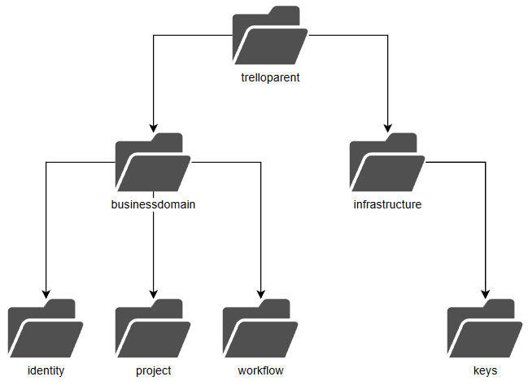
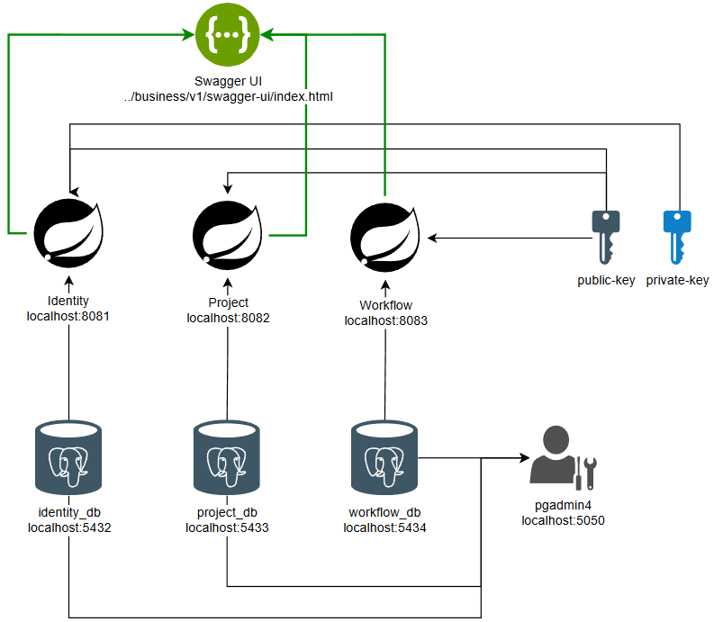
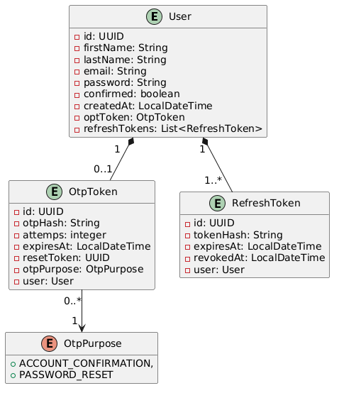
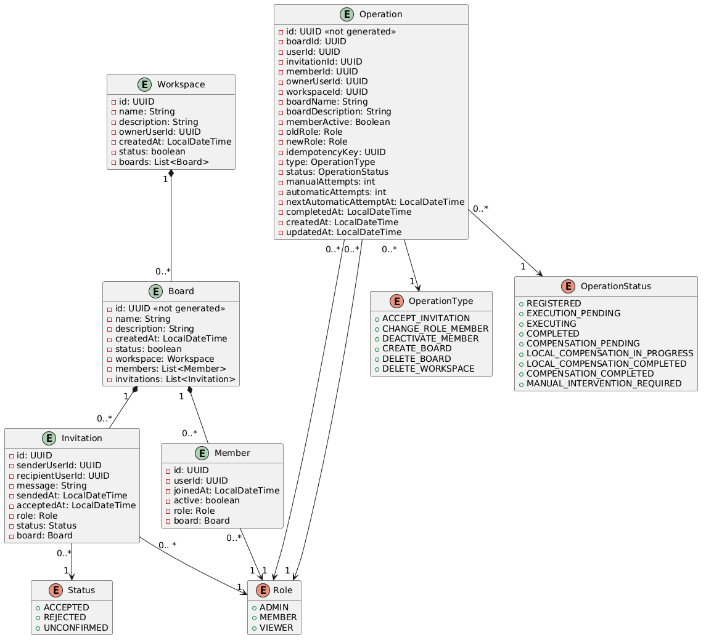
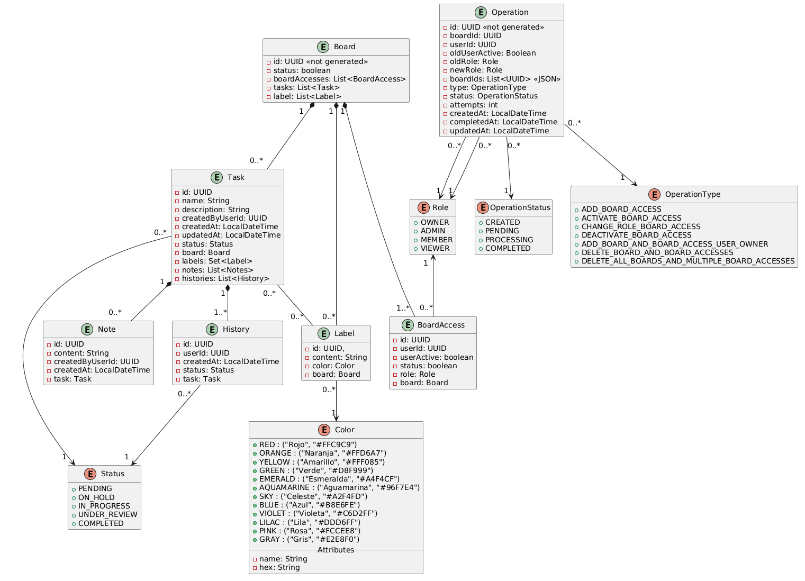

# TrelloMicroservices

"Microservicios en un monorepositorio para una aplicación de Trello" - ArmandoEnrique1010k

---
# Índice
- [Introducción](#Introducción)
	- [Descripción del proyecto](#Descripción del proyecto)
	- [Objetivos](#Objetivos)
	- [Tecnologías utilizadas](#Tecnologías%20utilizadas)
	- [Características principales](#Características%20principales)
- Arquitectura del proyecto
- Diseño funcional y modelo de datos
- Configuración y ejecución del proyecto
- Decisiones de arquitectura e implementación
- Autenticación y autorización con Spring Security y OAuth2
- Implementación de Resend para el envio de correos
- MapStruct y mapeo de objetos
- Documentación de API con Swagger UI
- Comunicación entre microservicios con OpenFeign
- Resiliencia y tolerancia a fallos entre microservicios
- Patrón SAGA y consistencia de datos entre microservicios
- Transacciones compensatorias
- Procesamiento de operaciones pendientes
- Escenarios de funcionamiento y tolerancia a fallos del patrón SAGA
- Bibliografía

---
# Introducción

El presente proyecto tiene como finalidad demostrar los conocimientos adquiridos en el desarrollo de APIs REST utilizando una arquitectura de microservicios con Spring Boot y Spring Cloud. Su construcción también permitió profundizar en la toma de decisiones de arquitectura de software, la comunicación entre servicios independientes y el manejo de operaciones distribuidas.

El desarrollo tomó como referencia dos cursos: **Microservicios y APIs REST con Spring Boot, OAuth2 y Docker**, de Carlos Adrián Soto Botero, y **React y TypeScript - La Guía Completa Creando +10 Proyectos**, de Juan Pablo de la Torre. En particular, se tomó como referencia la lógica de negocio de la aplicación UpTask desarrollada en este último curso, adaptándola y extendiéndola para trasladar su backend de una arquitectura monolítica basada en Node.js a una arquitectura de microservicios implementada con Spring Boot, incorporando nuevas funcionalidades y decisiones de diseño.

**Tiempo de desarrollo:** 3 meses.

## Descripción del proyecto

Se trata de una API REST que implementa la lógica de negocio de una aplicación de gestión de proyectos y tareas similar a Trello. Permite a los usuarios administrar espacios de trabajo, crear tableros y gestionar colaborativamente sus tareas, etiquetas y notas.

El funcionamiento de la aplicación comienza con el registro de un usuario, quien debe activar su cuenta mediante un código de verificación de seis dígitos enviado a su dirección de correo electrónico. Una vez activada la cuenta, puede iniciar sesión y comenzar a administrar sus espacios de trabajo.

Dentro de cada espacio de trabajo, el usuario puede crear tableros e invitar a otros usuarios registrados mediante su dirección de correo electrónico. Al enviar una invitación, debe asignar un rol que determinará los permisos y las operaciones que podrá realizar el usuario invitado dentro del tablero: ADMIN, MEMBER o VIEWER.

El destinatario de la invitación puede aceptarla o rechazarla. Si la acepta, adquiere acceso al tablero con los permisos correspondientes a su rol. Entre las funcionalidades disponibles se encuentran la creación y administración de tareas, la modificación de sus estados, la consulta de sus detalles, la gestión de notas y la visualización del historial de cambios realizados.

El backend está dividido en tres microservicios independientes:

- **Identity:** responsable de la gestión de usuarios, autenticación, autorización y administración de las credenciales.
- **Project:** encargado de la gestión de espacios de trabajo, tableros, invitaciones y membresías.
- **Workflow:** responsable de la gestión de los tableros a nivel operativo, incluyendo tareas, etiquetas, notas e historiales.

Cada microservicio dispone de su propia base de datos PostgreSQL, manteniendo la separación de responsabilidades y la autonomía de persistencia.

## Objetivos

Los principales objetivos del proyecto son:

- Aplicar conocimientos de arquitectura de software mediante la implementación de una arquitectura de microservicios.
- Demostrar la comunicación entre tres microservicios independientes mediante OpenFeign.
- Implementar mecanismos de autenticación y autorización utilizando Spring Security, OAuth2 y JWT.
- Aplicar patrones y herramientas para la gestión de errores, resiliencia y tolerancia a fallos en las comunicaciones entre microservicios.
- Implementar el patrón SAGA para gestionar operaciones distribuidas y mantener la consistencia de los datos entre diferentes bases de datos.
- Analizar el comportamiento y las limitaciones del patrón SAGA ante diferentes escenarios de fallos.
- Realizar pruebas funcionales de los endpoints mediante Swagger UI.
- Comprobar la persistencia y modificación de los datos en PostgreSQL a través de las operaciones ejecutadas desde Swagger UI.
- Utilizar Spring Boot Actuator para supervisar los servicios, consultar los estados de los Circuit Breakers y analizar sus eventos.
- Proporcionar una configuración de infraestructura y variables de entorno que permita reproducir el entorno de desarrollo local mediante Docker.

## Tecnologías utilizadas

Las siguientes son las principales tecnologías, frameworks y librerías utilizadas para el desarrollo de los microservicios.

### Núcleo y arquitectura base

| Tecnología       | Descripción                                                                                                 |
| ---------------- | ----------------------------------------------------------------------------------------------------------- |
| Java             | Lenguaje de programación principal del backend.                                                             |
| Spring Framework | Framework base que proporciona el contenedor de dependencias y los mecanismos de inyección de dependencias. |
| Spring Boot      | Simplifica la configuración, desarrollo y ejecución independiente de cada microservicio.                    |
| Spring Cloud     | Ecosistema de herramientas para implementar funcionalidades relacionadas con arquitecturas distribuidas.    |


### Persistencia y datos

| Tecnología      | Descripción                                                                                                    |
| --------------- | -------------------------------------------------------------------------------------------------------------- |
| Spring Data JPA | Abstracción para la persistencia y acceso a bases de datos mediante repositorios y consultas JPA.              |
| PostgreSQL      | Sistema de gestión de bases de datos relacional utilizado para almacenar la información de cada microservicio. |


### Desarrollo web y APIs

|Tecnología|Descripción|
|---|---|
|Spring Web|Desarrollo de endpoints REST y gestión de peticiones HTTP.|
|OpenAPI / Swagger UI|Documentación interactiva y ejecución de pruebas de los endpoints REST.|
|Spring Boot Starter Validation|Validación de datos de entrada mediante anotaciones de Bean Validation.|
|Resend|Servicio de envío de correos electrónicos transaccionales, utilizado para la activación de cuentas.|


### Mapeo y generación de código

|Tecnología|Descripción|
|---|---|
|MapStruct|Generación de código para realizar conversiones entre entidades, DTOs y otros objetos Java.|
|Lombok|Reducción de código repetitivo mediante anotaciones para generar constructores, getters, setters y otros métodos.|

![[README-1793759012822.webp|311]]

### Seguridad y autenticación

| Tecnología             | Descripción                                                               |
| ---------------------- | ------------------------------------------------------------------------- |
| Spring Security        | Gestión de autenticación, autorización y protección de endpoints.         |
| OAuth2 Resource Server | Validación de tokens JWT utilizados para autenticar las solicitudes HTTP. |

![[README-1793759107965.webp|143]]

### Comunicación entre microservicios y resiliencia

|Tecnología|Descripción|
|---|---|
|Spring Cloud OpenFeign|Cliente HTTP declarativo utilizado para la comunicación síncrona entre microservicios.|
|Apache HttpClient|Cliente HTTP utilizado para configurar y ejecutar peticiones que requieren métodos como PATCH.|
|Resilience4j Circuit Breaker|Aislamiento de fallos en las comunicaciones entre microservicios mediante el patrón Circuit Breaker.|
|Resilience4j Retry|Gestión de reintentos automáticos ante determinados errores en las comunicaciones.|
![[README-1793759171414.webp|267]]

### Observabilidad e infraestructura

| Tecnología           | Descripción                                                                                                                  |
| -------------------- | ---------------------------------------------------------------------------------------------------------------------------- |
| Spring Boot Actuator | Supervisión de los microservicios y consulta de información operativa, incluyendo estados y eventos de los Circuit Breakers. |
| Docker               | Contenedorización y configuración de la infraestructura necesaria para ejecutar el entorno de desarrollo local.              |

![[README-1793759308068.webp|306]]

## Características principales

- **Arquitectura de microservicios:** separación del backend en tres servicios independientes: Identity, Project y Workflow.
- **Monorepositorio:** organización centralizada del código fuente y configuración compartida de los microservicios.
- **Autenticación y autorización:** registro de usuarios, activación de cuentas mediante códigos de verificación, inicio de sesión y protección de endpoints mediante JWT.
- **Gestión de espacios de trabajo y tableros:** creación y administración de espacios de trabajo, tableros, invitaciones y membresías.
- **Control de acceso basado en roles:** asignación de permisos a los miembros de un tablero según su rol.
- **Gestión de tareas:** creación, modificación y consulta de tareas, incluyendo sus estados, notas e historial de cambios.
- **Comunicación entre microservicios:** integración mediante OpenFeign para ejecutar operaciones y consultar información de otros servicios.
- **Resiliencia y tolerancia a fallos:** utilización de Circuit Breaker, Retry y Fallback Factory para gestionar problemas de disponibilidad y latencia en las comunicaciones.
- **Consistencia de datos mediante SAGA:** registro de operaciones distribuidas, seguimiento de sus estados y ejecución de transacciones compensatorias ante operaciones fallidas.
- **Procesamiento en segundo plano:** ejecución programada de tareas relacionadas con la recuperación y el procesamiento de operaciones pendientes.
- **Documentación y pruebas de API:** utilización de Swagger UI para explorar, documentar y ejecutar los endpoints de cada microservicio.
- **Supervisión de servicios:** utilización de Spring Boot Actuator para consultar información de ejecución y supervisar los mecanismos de resiliencia.
- **Infraestructura local con Docker:** configuración de los servicios y bases de datos necesarios para reproducir el entorno de desarrollo.

---
# Arquitectura del proyecto


---
---

### Núcleo y arquitectura base

| Tecnología       | Descripción                                                                                                                                                                                                                                                  |
| :--------------- | :----------------------------------------------------------------------------------------------------------------------------------------------------------------------------------------------------------------------------------------------------------- |
| Java             | El lenguaje de programación principal que utiliza el proyecto.                                                                                                                                                                                               |
| Spring Framework | El núcleo central que provee la gestión de dependencias (Inyección de Dependencias) y el contenedor principal para configurar y enlazar todos los componentes de la aplicación.                                                                              |
| Spring Boot      | La evolución de Spring que simplifica drásticamente la configuración inicial y el empaquetado, permitiendo levantar microservicios independientes y listos para producción con un servidor embebido (como Tomcat) y dependencias autogestionadas (starters). |
| Spring Cloud     | El ecosistema de herramientas diseñado específicamente para manejar patrones distribuidos en arquitecturas de microservicios (como descubrimiento de servicios, balanceo de carga, pasarelas de API y configuración centralizada).                           |
### Persistencia y datos

| Tecnología      | Descripción                                                                                                                                                                                                  |
| :-------------- | :----------------------------------------------------------------------------------------------------------------------------------------------------------------------------------------------------------- |
| Spring Data JPA | Capa de abstracción sobre JPA/Hibernate que simplifica enormemente la interacción con bases de datos relacionales mediante la creación automática de repositorios y consultas basadas en nombres de métodos. |
| PostgreSQL      | El sistema de gestión de bases de datos relacional robusto, concurrente y altamente escalable, ideal para persistir de manera transaccional la información de los servicios.                                 |

### Desarrollo web y APIs

| Tecnología                     | Descripción                                                                                                                                                                             |
| :----------------------------- | :-------------------------------------------------------------------------------------------------------------------------------------------------------------------------------------- |
| Spring Web                     | El módulo enfocado en la creación de aplicaciones web y servicios RESTful utilizando controladores, manejo de peticiones HTTP y serialización JSON (vía Jackson).                       |
| OpenAPI y Swagger              | Estándar y conjunto de herramientas para documentar interactivamente las APIs REST, facilitando la comprensión de endpoints, esquemas de datos y contratos entre servicios o clientes.  |
| Spring Boot Starter Validation | Módulo que integra la especificación Bean Validation para validar automáticamente los datos de entrada en las peticiones HTTP (DTOs) mediante anotaciones (`@NotNull`, `@Email`, etc.). |
| Resend (envio de emails)       | Servicio moderno enfocado en desarrolladores para el envío rápido, seguro y programático de correos electrónicos transaccionales desde los microservicios mediante una API clara        |
### Optimizadores de código

| Tecnología | Descripción                                                                                                                                                                                                              |
| :--------- | :----------------------------------------------------------------------------------------------------------------------------------------------------------------------------------------------------------------------- |
| Mapstruct  | Generador de código por anotaciones que mapea de manera eficiente y en tiempo de compilación objetos Java (por ejemplo, entre Entidades de base de datos y DTOs), evitando el rendimiento lento del mapeo por reflexión. |
| Lombok     | Librería que reduce el código repetitivo (_boilerplate_) en las clases Java mediante anotaciones (`@Getter`, `@Setter`, `@Builder`, `@Data`), generando automáticamente constructores, métodos y utilidades              |


### Seguridad y autenticación

| Tecnología      | Descripción                                                                                                                                                                                                     |
| :-------------- | :-------------------------------------------------------------------------------------------------------------------------------------------------------------------------------------------------------------- |
| Spring Security | Framework robusto y altamente personalizable encargado de proteger los endpoints mediante autenticación, control de accesos y mitigación de vulnerabilidades comunes                                            |
| OAuth2          | Protocolo estándar de la industria para la autorización delegada y el manejo seguro de tokens de acceso (como JWT), fundamental para autenticar solicitudes entre pasarelas, microservicios y clientes externos |
### Comunicación entre microservicios y resiliencia

| Tecnología         | Descripción                                                                                                                                                                       |
| :----------------- | :-------------------------------------------------------------------------------------------------------------------------------------------------------------------------------- |
| OpenFeign          | Cliente HTTP declarativo que simplifica la comunicación síncrona entre microservicios; permite realizar llamadas inter-servicio escribiendo interfaces con anotaciones Spring MVC |
| HttpClient         | Cliente HTTP subyacente (como el moderno `HttpClient` de Java o Apache HttpClient) utilizado para enviar peticiones de red de bajo nivel o configuradas a servicios externos      |
| Resilience4j       | Librería ligera de tolerancia a fallos diseñada para programación funcional, ideal para aislar microservicios ante fallos en cascada                                              |
| Resilience4j Retry | Módulo específico de Resilience4j que permite reintentar automáticamente llamadas fallidas a servicios externos o bases de datos tras un error transitorio                        |

### Observabilidad y despliegue

| Tecnología | Descripción                                                                                                                                                                                                               |
| :--------- | :------------------------------------------------------------------------------------------------------------------------------------------------------------------------------------------------------------------------ |
| Actuator   | Módulo de Spring Boot que expone métricas operativas de la aplicación (salud, estado de conexiones, uso de memoria) mediante endpoints listos para ser monitoreados por herramientas externas (como Prometheus o Grafana) |
| Docker     | Plataforma de contenedores que empaqueta cada microservicio junto con su entorno y dependencias, garantizando que se ejecute de manera idéntica en cualquier infraestructura (desarrollo, pruebas o producción)           |


---
---


# Introducción
El presente proyecto demuestra las capacidades que adquiri en cuanto a la construcción de una API REST hecha en una arquitectura de microservicios.

Tambien fue construido para adquirir los conocimientos adquiridos en el curso de ### Microservicios y APIs REST con Spring Boot, OAuth2 y Docker de Carlos Adrian Soto Botero, y otros conceptos que he adquirido en el tiempo.

Además de la lógica de la aplicación de UpTask del curso de React de Juan Pablo de la Torre, ### React y TypeScript - La Guía Completa Creando +10 Proyectos llevandolo a una arquitectura de microservicios pasando del ecosistema de Node.js (arquitectura monolitica del backend) al ecosistema de Spring Boot, con algunos nuevos cambios aplicados.

Tiempo de construcción: 3 meses

## Descripción del proyecto

Se trata de una API REST que utilizaria un sistema Trello, en donde un usuario puede administrar espacios de trabajos y tableros, en el cual puede incluir miembros, tareas, etiquetas y notas.

El usuario inicialmente se tiene que registrar y luego activar su cuenta mediante el envio de un token de 6 digitos a su correo real por medio de gmail o outlook, luego de activar su cuenta, podra iniciar sesión, seguidamente puede administrar espacios de trabajo, en donde en cada espacio de trabajo puede crear tableros, dentro de esos tableros puede enviar una invitación hacia otro usuario registrado en la base de datos, buscandolo mediante su email registrado, debe agregarle un rol al usuario que sera miembro (ADMIN, MEMBER o VIEWER).

El usuario remitente de la invitacion puede aceptar la invitacion o rechazarla, si la acepta, entonces sera miembro del tablero y el usuario de acuerdo a su rol adquirido podra realizar las operaciones con limitaciones debido a su rol como crear una tarea, cambiar el estado de una tarea, obtener detalles de una tarea como las notas de la tarea, el historial de cambios del estado de la tarea, etc.

## Objetivos

- Toma de decisiones a nivel de arquitectura de software.
- Demostrar la ejecución de un entorno de desarrollo del backend de una aplicación de tipo Trello con 3 microservicios.
- Realizar pruebas en la UI de Swagger con los distintos endpoints.
- Registrar datos introducidos en la base de datos desde la UI de Swagger.
- Usar Actuator para depurar.
- Probar los endpoints que dependen de otros microservicios cuando el microservicio tiene un problema como si estuviera desactivado o demora más de la cuenta.
- Demostrar los limites del patrón SAGA.
- Proporcionar una configuración del proyecto en un entorno de desarrollo para ejecutar el proyecto.


## Tecnologías utilizadas
- Spring Framework
- Spring Boot
- Spring Cloud
- Spring Data JPA
- Spring Web
- Mapstruct
- Lombok
- OpenAPI y Swagger
- Spring boot starter validation
- Spring Security
- Oauth2
- Resend (envio de emails)
- OpenFeign
- HttpClient
- Resilience4j
- Resilence4j retry
- Postgresql
- Actuator
- Docker


# Arquitectura del proyecto
Se han tenido en cuenta varios conceptos relacionados a arquitectura de software, comenzando por:
## Patrón de monorepositorio

Construyendo microservicios de Oreilly

El proyecto utiliza el **patrón de monorepositorio (monorepo)** para organizar los diferentes microservicios y módulos que conforman la aplicación...

Bajo este enfoque, el código fuente de los distintos microservicios se mantiene dentro de un único repositorio. Esto permite centralizar el código del proyecto y facilita la reutilización de componentes y configuraciones comunes entre los diferentes módulos.

La estructura del proyecto aprovecha el sistema de gestión de dependencias de **Maven** y el modelo de herencia de proyectos de **Spring Boot/Maven**. En este caso, el proyecto utiliza un módulo padre denominado **`trelloparent`**, del cual hereda configuración y dependencias el módulo `**businessdomain**`. A partir de esta estructura se organizan los diferentes microservicios y módulos que forman parte del sistema.

Esta organización permite mantener una estructura común para los microservicios y compartir elementos que son necesarios en más de un módulo, evitando duplicar configuraciones y dependencias.

La siguiente imagen muestra la estructura de carpetas del repositorio y la relación entre los diferentes módulos:




## Diagrama de solución funcional en un entorno de desarrollo local

El siguiente diagrama representa la **solución funcional del sistema en un entorno de desarrollo local**.

En él se muestran los principales componentes que intervienen en la ejecución de la aplicación, incluyendo los microservicios desarrollados con **Spring Boot**, las bases de datos **PostgreSQL** utilizadas por cada microservicio y **pgAdmin 4** como herramienta para la administración de las bases de datos.

El diagrama también representa los elementos relacionados con la seguridad y la comunicación entre los componentes, como el uso del par de claves **RSA** para la generación, firma y validación de los tokens **JWT**, así como las URL utilizadas para acceder a las interfaces de **Swagger UI** de cada microservicio.

De esta manera, el diagrama proporciona una visión general de cómo se distribuyen los componentes del sistema y cómo se relacionan entre sí durante el desarrollo y ejecución local de la aplicación.



## Diagrama UML de entidades

Los siguientes 3 diagramas UML representan el **modelo de entidades de los microservicios que contienen la lógica de negocio**.

Cada microservicio mantiene su propio conjunto de entidades, las cuales representan los principales elementos del dominio y las relaciones existentes entre ellos.

El diagrama permite visualizar la estructura del modelo de datos de cada microservicio, incluyendo sus entidades, atributos y relaciones. Esto facilita la comprensión de cómo se encuentra organizado el dominio dentro de cada servicio y cómo se distribuyen las responsabilidades entre los diferentes microservicios.

### Identity



### Project



### Workflow



## Generación de claves RSA para JWT

El microservicio `identity` utiliza un par de claves RSA para firmar y validar los tokens JWT:

- `private-key.pem`: clave privada utilizada para **firmar** los JWT.
- `public-key.pem`: clave pública utilizada para **verificar** los JWT.

> **Importante:** nunca compartas ni subas `private-key.pem` al repositorio. La clave privada debe mantenerse protegida.

Por otro lado, los microservicios `Project` y `Workflow` utilizan la clave pública para verificar el JWT que se pasa en el encabezado (header) de una petición.

### 1. Instalar OpenSSL

Si OpenSSL todavía no está instalado, abre PowerShell y ejecuta:

```powershell
winget install openssl
```

Cuando se solicite, escribe `Y` para aceptar los términos y condiciones.

Después de la instalación, **cierra PowerShell y abre una nueva terminal**.

Comprueba que OpenSSL está instalado:

```powershell
winget list openssl
```

Deberías obtener una salida similar a:

```text
Name                   Id                       Version Source
---------------------------------------------------------------
OpenSSL 4.0.1 (64-bit) ShiningLight.OpenSSL.Dev 4.0.1   winget
```

### 2. Verificar que OpenSSL esté disponible en el PATH

Ejecuta:

```powershell
where.exe openssl
```

Si no encuentra el ejecutable, puedes localizarlo con:

```powershell
Get-ChildItem "C:\Program Files" -Filter openssl.exe -Recurse -ErrorAction SilentlyContinue
```

La instalación de OpenSSL utilizada por el proyecto debe encontrarse en:

```text
C:\Program Files\OpenSSL-Win64\bin\openssl.exe
```

Comprueba directamente su versión:

```powershell
& "C:\Program Files\OpenSSL-Win64\bin\openssl.exe" version
```

Deberías obtener:

```text
OpenSSL 4.0.1 9 Jun 2026 (Library: OpenSSL 4.0.1 9 Jun 2026)
```

### 3. Agregar OpenSSL al PATH

Si el comando `openssl` no es reconocido directamente desde PowerShell, agrega la siguiente ruta a las variables de entorno:

```text
C:\Program Files\OpenSSL-Win64\bin
```

Pasos:

1. Presiona `Windows + R`.
2. Ejecuta `sysdm.cpl`.
3. Ve a **Opciones avanzadas**.
4. Selecciona **Variables de entorno**.
5. En **Variables de usuario**, selecciona `Path`.
6. Pulsa **Editar**.
7. Pulsa **Nuevo**.
8. Agrega:

```text
C:\Program Files\OpenSSL-Win64\bin
```

9. Acepta todas las ventanas.
10. Cierra todas las terminales abiertas.
11. Abre una nueva terminal de PowerShell.

Finalmente, verifica:

```powershell
openssl version
```

y:

```powershell
where.exe openssl
```

La segunda orden debería mostrar:

```text
C:\Program Files\OpenSSL-Win64\bin\openssl.exe
```

### 4. Generar las claves RSA

Ubícate en el directorio `keys` del modulo `infrastructure`:

```powershell
cd infrastructure\keys
```

Genera la **clave privada**:

```powershell
openssl genrsa -out private-key.pem 2048
```

Luego genera la **clave pública** a partir de la clave privada:

```powershell
openssl rsa -in private-key.pem -pubout -out public-key.pem
```

El directorio debe quedar de esta manera:

```text
infrastructure/
└── keys/
    ├── private-key.pem
    └── public-key.pem
```

### 5. Verificar las claves

Puedes comprobar que la clave privada se haya generado correctamente con:

```powershell
openssl rsa -in private-key.pem -check
```

Deberías obtener:

```text
RSA key ok
```

También puedes comprobar la clave pública:

```powershell
openssl rsa -pubin -in public-key.pem -text -noout
```

### 6. No subir la clave privada a Git

Agrega la clave privada al `.gitignore`:

```gitignore
# JWT RSA keys
infrastructure/keys/private-key.pem
```

Si las claves se generan únicamente para desarrollo local, también puedes ignorar todo el directorio:

```gitignore
infrastructure/keys/*.pem
```

En producción, la clave privada debería gestionarse mediante un mecanismo seguro de secretos y **no almacenarse directamente en el repositorio**.

## Configuración de la infraestructura

El proyecto utiliza **Docker Compose** para definir y ejecutar la infraestructura necesaria para el funcionamiento de los microservicios en un entorno de desarrollo local.

Cada microservicio de lógica de negocio —**Identity**, **Project** y **Workflow**— utiliza una instancia independiente de **PostgreSQL**. Para facilitar la administración de las bases de datos se utiliza **pgAdmin 4**, también ejecutado mediante Docker.

La infraestructura se encuentra definida en el archivo:

```
docker-compose.yml
```

La configuración contempla los siguientes servicios:

| Servicio   | Contenedor    | Puerto |
| ---------- | ------------- | ------ |
| PostgreSQL | `identity-db` | `5432` |
| PostgreSQL | `project-db`  | `5433` |
| PostgreSQL | `workflow-db` | `5434` |
| pgAdmin 4  | `pgadmin4`    | `5050` |

> **Nota:** los puertos `5433` y `5434` corresponden a los puertos expuestos en el equipo local. Dentro de la red de Docker Compose, cada instancia de PostgreSQL utiliza su puerto interno `5432`.

### 1. Levantar la infraestructura

Ubícate en el directorio donde se encuentra el archivo `docker-compose.yml` y ejecuta:

```bash
docker compose up -d
```

La opción `-d` permite ejecutar los contenedores en segundo plano.

Para comprobar que los servicios se encuentran ejecutándose correctamente:

```bash
docker compose ps
```

También puedes utilizar:

```bash
docker ps
```

Deberían aparecer los cuatro contenedores correspondientes a las tres instancias de PostgreSQL y pgAdmin 4.
### 2. Verificar PostgreSQL

Para comprobar que una instancia de PostgreSQL se inició correctamente, puedes consultar los logs del contenedor:

```bash
docker logs identity-db
```

Cuando PostgreSQL haya iniciado correctamente, debería aparecer un mensaje similar a:

```text
database system is ready to accept connections
```

Este mensaje indica que el servidor PostgreSQL está ejecutándose y puede aceptar conexiones.

También puedes consultar los logs desde **Docker Desktop**, accediendo al panel **Containers**, seleccionando el contenedor correspondiente y abriendo la pestaña **Logs**.

La configuración de la base de datos de Identity es:

```text
Database: identity_db
Username: postgres
Password: admin
Port: 5432
```

Las bases de datos de los demás microservicios siguen una configuración equivalente:

```
Project:
Database: project_db
Username: postgres
Password: admin
Port: 5432

Workflow:
Database: workflow_db
Username: postgres
Password: admin
Port: 5432
```

> **Importante:** las variables `POSTGRES_DB`, `POSTGRES_USER` y `POSTGRES_PASSWORD` se utilizan para inicializar PostgreSQL cuando el directorio de datos se encuentra vacío. Si el directorio ya contiene un clúster de PostgreSQL inicializado, modificar estas variables no volverá a ejecutar el proceso de inicialización.

### 3. Verificar pgAdmin 4

Para comprobar que pgAdmin 4 se inició correctamente, consulta los logs de su contenedor:

```bash
docker logs pgadmin4
```

Debería aparecer un mensaje similar a:

```text
[INFO] Listening at: http://[::]:80 (1)
```

Esto indica que pgAdmin está escuchando correctamente dentro del contenedor.

También puedes comprobar el estado del contenedor desde **Docker Desktop**.

### 4. Acceder a pgAdmin 4

Una vez que el contenedor se encuentre ejecutándose, abre pgAdmin 4 desde el navegador:

[http://localhost:5050/](http://localhost:5050/)

Utiliza las credenciales definidas en `docker-compose.yml`:

```text
Email:    admin@gmail.com
Password: qwerty
```

### 5. Registrar las bases de datos en pgAdmin 4

Una vez dentro de pgAdmin 4, es necesario registrar las tres instancias de PostgreSQL.

En el panel izquierdo:

1. Haz clic derecho sobre **Servers**.
2. Selecciona **Register → Server...**.
3. Configura las pestañas **General** y **Connection**.
4. Pulsa **Save**.

#### Identity

En la pestaña **General**, utiliza:

```
Name: identity-postgres-db
```

Este nombre es únicamente un identificador dentro de pgAdmin y no tiene que coincidir con el nombre del contenedor.

En la pestaña **Connection**:

|Campo|Valor|
|---|---|
|Host name/address|`identity-postgres-db`|
|Port|`5432`|
|Maintenance database|`identity_db`|
|Username|`postgres`|
|Password|`admin`|

El valor `identity-postgres-db` corresponde al nombre del servicio de Docker Compose utilizado para establecer la comunicación entre los contenedores.

> **Importante:** cuando pgAdmin y PostgreSQL se encuentran dentro de la misma red de Docker Compose, no se debe utilizar `localhost` como host para establecer la conexión entre ambos contenedores. Se utiliza el nombre del servicio definido en Docker Compose.

#### Project
Registra un nuevo servidor desde **Register → Server...**.

En la pestaña **General**:

```
Name: project-postgres-db
```

En la pestaña **Connection**:

| Campo                | Valor                 |
| -------------------- | --------------------- |
| Host name/address    | `project-postgres-db` |
| Port                 | `5432`                |
| Maintenance database | `project_db`          |
| Username             | `postgres`            |
| Password             | `admin`               |
#### Workflow

Registra un tercer servidor.

En la pestaña **General**:

```
Name: workflow-postgres-db
```

En la pestaña **Connection**:

| Campo                | Valor                  |
| -------------------- | ---------------------- |
| Host name/address    | `workflow-postgres-db` |
| Port                 | `5432`                 |
| Maintenance database | `workflow_db`          |
| Username             | `postgres`             |
| Password             | `admin`                |

### 6. Verificar la base de datos

Después de registrar los servidores, puedes acceder a las bases de datos desde el árbol de navegación de pgAdmin.

Por ejemplo, para **Identity**:

```text
Servers
└── identity-postgres-db
    └── Databases
        └── identity_db
            └── Schemas
                └── public
                    └── Tables
```

Dentro de **Tables** deberían aparecer las tablas correspondientes a las entidades del microservicio Identity.

La creación y actualización de las tablas es gestionada por Hibernate mediante:

```properties
spring.jpa.hibernate.ddl-auto=update
```

Por lo tanto, las tablas serán creadas o actualizadas cuando el microservicio establezca correctamente la conexión con PostgreSQL.

El mismo procedimiento puede utilizarse para las bases de datos `project_db` y `workflow_db`.

### 7. Ejecutar los microservicios

Una vez que la infraestructura se encuentre disponible, puedes ejecutar los microservicios **Identity**, **Project** y **Workflow** desde el IDE o mediante Maven.

En VS Code, puedes utilizar **Spring Boot Dashboard** para administrar la ejecución de los módulos Spring Boot.

Dentro de la sección **Maven** podrás encontrar los diferentes módulos del proyecto.

Para cada microservicio se pueden utilizar las siguientes fases:

- `clean`: elimina los archivos generados durante compilaciones anteriores.
- `compile`: compila el código fuente y permite detectar errores de compilación.
- `package`: compila el proyecto y genera el artefacto correspondiente.

#### Ejecución desde Spring Boot Dashboard

Para ejecutar un microservicio:

1. Abre **Spring Boot Dashboard**.
2. Busca la sección **Apps**.
3. Localiza el microservicio que deseas ejecutar.
4. Pulsa **Run**.
5. Consulta los logs desde la consola integrada de VS Code.

#### Ejecución mediante Maven

También puedes ejecutar los microservicios desde una terminal externa, como PowerShell o **Warp**.

Por ejemplo, para ejecutar **Project**:

```
cd C:/projects/TrelloMicroservices/trelloparent/businessdomain/project
```

Luego ejecuta:

```
mvn spring-boot:run
```

Puedes utilizar `../` para desplazarte hacia el directorio padre desde la ubicación actual.

Repite el procedimiento para los microservicios **Identity** y **Workflow**.

### 8. Acceder a Swagger

Cada microservicio expone su propia interfaz de **Swagger UI**.

#### Identity

```
http://localhost:8081/business/v1/swagger-ui/index.html
```

#### Project

```
http://localhost:8082/business/v1/swagger-ui/index.html
```

#### Workflow

```
http://localhost:8083/business/v1/swagger-ui/index.html
```

La estructura de estas URL es:

```
http://localhost
       :PORT
       /business/v1
       /swagger-ui/index.html
```

Donde:

- `PORT` corresponde al puerto asignado al microservicio.
- `/business/v1` corresponde al `server.servlet.context-path`.
- `/swagger-ui/index.html` corresponde a la interfaz de Swagger UI.

## Limpiar los datos

### 1. Detener los contenedores

Para detener toda infraestructura, ejecuta en la terminal:

```bash
docker compose down
```

Esto detiene y elimina los contenedores, pero **no elimina los datos almacenados en `postgres_data`**.
### 2. Cambiar la configuración inicial de PostgreSQL

Tomando el microservicio Project, si se modifica alguna de las siguientes propiedades:

```yaml
POSTGRES_USER: postgres
POSTGRES_PASSWORD: admin
POSTGRES_DB: identity_db
```

y se necesita que PostgreSQL realice nuevamente su inicialización, primero se debe detener la infraestructura:

```bash
docker compose down
```

Después, elimina el directorio:

```text
postgres_data_project/
```

Finalmente, vuelve a levantar los servicios:

```bash
docker compose up -d
```

Esto es necesario porque PostgreSQL **no vuelve a ejecutar su proceso de inicialización mientras el directorio `/var/lib/postgresql/data` ya contenga un clúster existente**.

> ⚠️ **Advertencia:** eliminar `postgres_data_project` elimina los datos almacenados en esa instancia de PostgreSQL. Hazlo solamente si no necesita conservar los datos de los demás microservicios.


## Comprobar un password BCrypt

Después de registrar un usuario desde Swagger, puedes consultar el password almacenado en PostgreSQL mediante pgAdmin4.

El valor almacenado será un hash BCrypt, por ejemplo:

```text
$2a$10$...
```

Para comprobar si una contraseña corresponde con ese hash puedes utilizar:

[BCrypt Generator](https://bcrypt-generator.com/?utm_source=chatgpt.com)

Introduce:

- **Password:** la contraseña original utilizada durante el registro.
- **Hash:** el valor BCrypt almacenado en la columna `password` de PostgreSQL.

> ⚠️ No utilices contraseñas reales o sensibles en servicios web de terceros. Para pruebas de desarrollo utiliza únicamente contraseñas ficticias.
